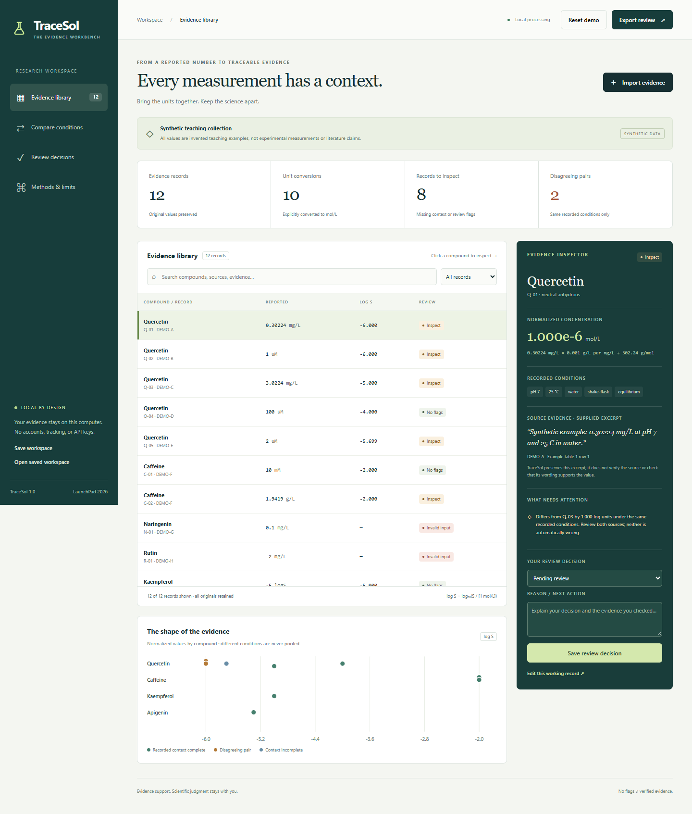

# TraceSol

**Solubility evidence, in context.** A local research workbench for chemistry students and researchers who need to compare reported solubilities without losing their units, experimental conditions, or source evidence.

Created from scratch for **LaunchPad Hacks**, November 2026. Video is optional; this package uses a downloadable application, screenshots, and a written walkthrough.

**[Source code](https://github.com/nbach-hoang/tracesol)** | **[Download the project ZIP](https://github.com/nbach-hoang/tracesol/archive/refs/heads/main.zip)**

This is a downloadable local application. Extract the ZIP and follow the setup steps below.



## Start in two minutes

1. Extract the ZIP into a normal folder. Do not run from inside the ZIP.
2. On Windows, double-click **START_TRACESOL.cmd**. Keep the window open.
3. Open **http://127.0.0.1:8765** in your browser after the ready message.
4. The synthetic teaching dataset loads automatically. No account, internet connection, API key, or paid service is needed.

Requires **Python 3.10 or later** and a modern browser. The Windows launcher can also discover the Python runtime bundled with the Codex desktop app. There are **no pip dependencies**.

On any platform, from the project folder:

```text
python app.py
```

If your system uses `python3`, run `python3 app.py`. If the port is busy, run `python app.py --port 8766` and open the printed address. Stop the server with **Ctrl+C**. Closing a browser tab does not stop the server.

## The useful first demonstration

1. Select **Q-01**: 0.30224 mg/L divided by 302.24 g/mol converts to 1 × 10^-6 mol/L.
2. Select **Q-02**: 1 uM converts to the same value. Different units do not imply different concentrations.
3. Open **Compare conditions**: Q-03 is ten times higher under the same recorded conditions. TraceSol flags both comparisons against Q-01 and Q-02, without declaring any source wrong.
4. Q-04 has a different pH, and Q-06 a different chemical form. These pairs are separated rather than called disagreements.
5. Inspect Q-05: missing pH prevents a complete-context comparison. N-01 lacks molecular weight; R-01 is a negative concentration. Both fail conversion.
6. Record a review decision with your reason. Export a CSV, full JSON audit, printable HTML report, or editable workspace.

**All demonstration values are synthetic. They are not measurements, literature-derived labels, or estimates of the real solubility of the named compounds.** Molecular weights are demonstration inputs, not independently verified identity assignments.

## What is implemented

- CSV import and paste, BOM/multiline handling, explicit schema errors, up to 500 rows / 2 MB.
- Seventeen supported unit representations, including molar prefixes, mass-per-volume units, and logS.
- Conversion calculation for each valid record; invalid, zero, negative, and non-finite inputs are rejected.
- Comparisons using compound label, chemical form, solvent, pH, temperature, method, and measurement kind.
- Configurable disagreement thresholds, missing-context handling, and possible repeated-evidence flags.
- Source excerpts and page/table locators beside the original values.
- Search, status filters, concentration overview, accessible inspector, and responsive layouts.
- Human decisions with required reasons; record edits reset the edited decision and append edit history.
- Workspace export/reopen, audit JSON, spreadsheet-safe CSV, and self-contained HTML report.
- Local-only Python server with a fixed public-file allowlist, host/origin checks, and no uploaded-text logging.
- Automated calculation/server tests and a separate end-to-end browser verification script.

## Your own evidence

Use `data/template.csv` or the in-app template download. Mandatory headers:

```text
record_id,compound,value,unit
```

Use the full template to include `form,mw_g_mol,solvent,ph,temperature_c,method,measurement_kind,source,evidence,source_locator`.

For text with commas or line breaks, use normal CSV quoting. Extra columns are retained in the raw-record JSON and workspace. The reviewed CSV contains the documented core schema and audit columns; use JSON if extra columns matter.

No default pH, temperature, molecular weight, chemical form, or experimental method is invented. Unknown information stays missing. Use equilibrium, intrinsic, apparent, or kinetic as the measurement kind. Text matching is case-insensitive with whitespace normalized; molecular structures and synonyms are not resolved.

## Save your work

The server does not store uploads. Browser reloads start a new demo session. Choose **Save workspace** before closing or replacing a collection, then use **Open saved workspace** to continue. Workspace JSON contains your evidence and edit history; keep confidential files private. Full audit JSON is a readout, not an editable workspace.

Review decisions annotate evidence; excluded records remain visible in exports. No model-training dataset is silently created. Editing a record resets its own decision; existing decisions on other rows are retained and should be revisited if comparisons change.

## Verify or use from the command line

```text
python -m unittest discover -s tests -v
python app.py --audit data/demo.csv --output output/demo-audit.json
```

Browser QA is optional and uses Node + Playwright for development only:

```text
node scripts/browser_qa.cjs
```

Start the app first. Install Playwright separately if needed. Set `TRACESOL_BROWSER=msedge` to use installed Edge, or use a Playwright Chromium installation. `TRACESOL_PLAYWRIGHT` can point to a preinstalled Playwright module. The app itself never needs Node.

The recorded validation is in `docs/VALIDATION.md` and `output/browser-qa.json`.

## Project map

| Location | Purpose |
|---|---|
| `app.py` | Local HTTP server and command-line audit |
| `tracesol/engine.py` | Pure Python import, conversion, review, and export rules |
| `web/` | HTML/CSS/JavaScript interface; local assets only |
| `data/` | Synthetic demo and blank input template |
| `tests/` | Automated calculation and server tests |
| `docs/` | Methods, requirements mapping, credits, validation, and comparison with prior prototype |
| `submission/` | Copy-ready Devpost text, judge guide, cover image, screenshots, and checklist |
| `output/` | Example audits/reports and recorded browser verification |
| `scripts/` | Browser QA and release packaging |

## Scientific limits

TraceSol is a review aid, not a solubility predictor or paper-verification service. Matching recorded conditions does not establish full experimental equivalence. It does not resolve chemical identity, read PDFs, verify quotations or DOIs, select the correct source, or infer missing conditions. It cannot establish model readiness or clinical suitability. See `docs/METHODS.md`.

## Credits and license

New code, interface, synthetic examples, tests, and documentation were generated during the hackathon period with an AI coding assistant. No source code or private datasets were copied from the previous Carbon Decision Engine, MERLIN, or ai-pharma projects. Those projects informed problem selection only. The runtime uses deterministic rules and makes no AI calls. Scientific references and third-party acknowledgments are in `docs/CREDITS.md`. MIT license; see `LICENSE`.

Source code and project files are published at https://github.com/nbach-hoang/tracesol. The GitHub ZIP link above provides the downloadable build; the working app runs locally with Python. Final Devpost submission has not been verified here. Student/age/geographic eligibility and account/team details require confirmation before entry.
